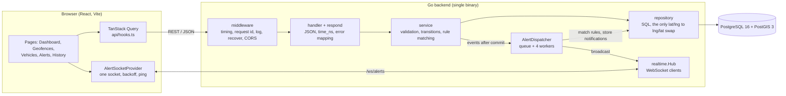
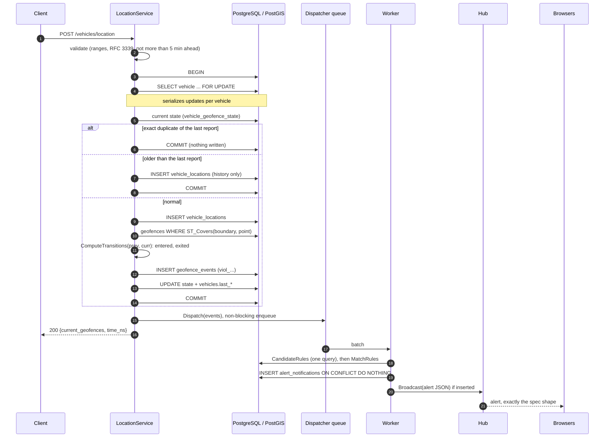
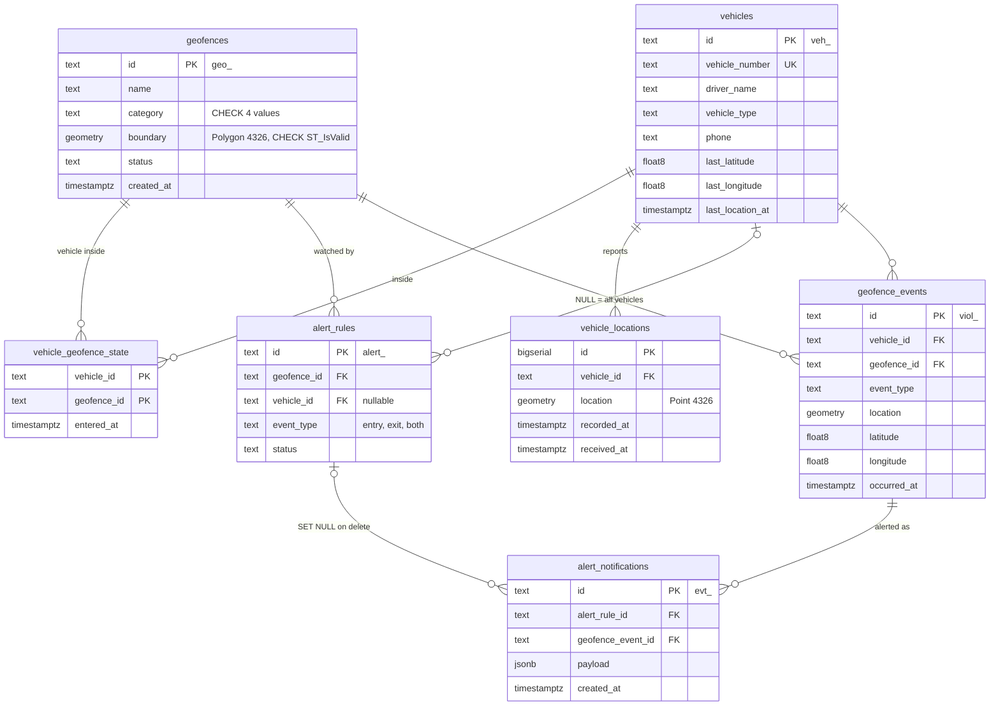

# Architecture

Go API (stdlib `net/http`, no framework) · PostgreSQL 16 + PostGIS 3 (pgx, hand-written SQL) ·
WebSocket alerts (gorilla/websocket) · React + Vite frontend. Package layout and conventions:
[CLAUDE.md](../CLAUDE.md); endpoints beyond the spec: [EXTRA_ENDPOINTS.md](EXTRA_ENDPOINTS.md);
deployment: [DEPLOYMENT.md](DEPLOYMENT.md).

- [Components](#components)
- [Location update sequence](#location-update-sequence)
- [Database schema and indexes](#database-schema-and-indexes)
- [Design decisions](#design-decisions)
- [Query performance](#query-performance)
- [Edge cases](#edge-cases)
- [Known limitations](#known-limitations)

## Components



| Package | Responsibility |
|---|---|
| `handler` | Decode/encode JSON, path & query params, routes (incl. JSON 404/405). No business rules. |
| `handler/respond` | `respond.JSON` stamps `time_ns`; `respond.Error` is the single error → status map (400/401/404/409/413/415/429/503/500). |
| `service` | Validation mirroring the spec, `ComputeTransitions`, rule matching, the location-update transaction script, the alert dispatcher. Declares the repository interfaces it needs. |
| `repository` | pgx + SQL. `geo.go` is the only place that converts `[lat, lng]` ↔ PostGIS `(lng lat)`. |
| `realtime` | WebSocket hub: one goroutine owns the client set; per-client read/write pumps. |
| `model` | Domain types, prefixed IDs (`geo_`, `veh_`, `alert_`, `viol_`, `evt_`), sentinel errors. |
| `db` | Pool with startup retry; embedded SQL migrations with an advisory lock. |

## Location update sequence

`POST /vehicles/location`: everything that must be consistent happens in one transaction;
alert delivery happens after commit and never delays the response.



## Database schema and indexes



Migrations are plain SQL files embedded in the binary (`backend/internal/db/migrations`), applied
at startup in order under a `pg_advisory_lock`, recorded in `schema_migrations`.
`0001_init.sql` starts with `CREATE EXTENSION IF NOT EXISTS postgis`.

| Index | Serves | Why |
|---|---|---|
| `geofences_boundary_gist` (GiST) | `ST_Covers(boundary, point)` on every location update | Bounding-box prefilter: only candidate polygons get the exact test. The hot path. |
| `geofences_category_idx` | `GET /geofences?category=` | Cheap; at a few hundred rows the planner may still prefer a seq scan. |
| `vehicles.vehicle_number` UNIQUE | duplicate detection (409) | The constraint *is* the check: no read-then-insert race. |
| `vehicle_geofence_state` PK `(vehicle_id, geofence_id)` | "where is this vehicle now" (diff, GET location, fleet) | One small row per vehicle × geofence it is inside. |
| `vehicle_geofence_state_geofence_idx` | `ON DELETE CASCADE` from geofences; "who is in this zone" | Without it, deleting a geofence scans the whole table. |
| `vehicle_locations (vehicle_id, recorded_at DESC)` | a vehicle's history, newest first | Append-only table that grows fastest. |
| `vehicle_locations_location_gist` | nothing yet | Kept for future spatial queries over history ("who passed here"); **unused today and costs insert time**, so it is a candidate to drop. |
| `alert_rules_geofence_idx`, `alert_rules_vehicle_idx` | `CandidateRules` (`geofence_id = ANY(...)`), `GET /alerts` filters, FK cascades | Matching runs for every batch of events. |
| `alert_rules_active_unique` (partial, `WHERE status='active'`, `COALESCE(vehicle_id,'')`) | 409 on an identical active rule | Race-free duplicate check; "all vehicles" (NULL) compares equal to itself; inactive rules don't block re-creation. |
| `geofence_events (vehicle_id, occurred_at DESC)`, `(geofence_id, occurred_at DESC)`, `(occurred_at DESC)` | `GET /violations/history` with each filter combination, newest first | Top-N index scans that stop after `LIMIT` rows (measured below). |
| `alert_notifications_event_rule_unique (geofence_event_id, alert_rule_id)` | dedupe: one notification per (event, rule) | Makes dispatch idempotent (`ON CONFLICT DO NOTHING`). |
| `alert_notifications_event_idx` | — | **Redundant** since 0003 (same leading column as the unique index); can be dropped. |
| `alert_notifications_created_idx` | `GET /alerts/notifications` newest first | Feed seed after page reload. |

## Design decisions

**`ST_Covers`, not `ST_Contains`/`ST_Within`.** `ST_Contains` is false for a point *on* the
boundary. A vehicle on the fence line of a restricted zone should alert, and a vehicle moving
along an edge must not flap between entry and exit. `ST_Covers` treats the boundary as
inside and is index-aware (GiST prefilter), so it costs the same.

**Row lock per vehicle (`SELECT … FOR UPDATE`).** Entry/exit is a diff between the stored
state and the new position. Two concurrent updates for one vehicle could both read the same
"before" state and both emit an entry. Locking the vehicle row serializes updates *per
vehicle* only (different vehicles never wait on each other). Isolation levels alone don't
fix this cleanly: SERIALIZABLE would need retry loops. `TestConcurrentUpdates` fires 20
parallel updates and fails if the lock is removed.

**Diff in Go, membership in SQL.** PostGIS answers "which geofences cover this point" with
one indexed query; the transition logic (`ComputeTransitions`) is a pure function, unit-tested
without a database (nested and overlapping zones included).

**Out-of-order reports go to history only.** Applying an older report would "rewind" the
vehicle and invent exit/entry pairs; re-deriving the past would rewrite alerts already
delivered. Exact duplicates are no-ops (safe client retries).

**Alerts after commit, through a bounded worker pool.** The HTTP handler only enqueues
(non-blocking channel send); 4 workers match rules (one query per batch), store one
notification per (event, rule) and broadcast. A goroutine per request would be unbounded
under load; doing it inline would put rule matching and every client's socket on the request
path. If the 1024-batch queue is ever full, the batch is processed inline (backpressure
rather than losing committed alerts). On shutdown the queue drains before the hub closes.

**One goroutine owns the WebSocket client set.** Register/unregister/broadcast are channel
messages, so there are no locks. Each client has a 256-message buffer; a client that stops
reading is dropped rather than slowing everyone. Alerts are sent as the exact spec object (no
envelope); control messages carry a `type` field.

**Errors are mapped in one place.** Services return typed domain errors
(`*ValidationError` with per-field `details`, `model.NewError(ErrConflict, msg)`, …);
`respond.Error` maps them to status codes, hides unknown errors behind a generic 500, and
turns database outages into 503 + `Retry-After`.

## Query performance

### GET /violations/history

Two statements run as one pipelined batch in a read-only REPEATABLE READ
transaction (same snapshot for page and count):

```sql
-- page
SELECT e.id, e.event_type, e.vehicle_id, v.vehicle_number, v.driver_name,
       e.geofence_id, g.name, g.category, e.latitude, e.longitude, e.occurred_at
FROM geofence_events e
JOIN vehicles v ON v.id = e.vehicle_id
JOIN geofences g ON g.id = e.geofence_id
WHERE <filters as $n params>
ORDER BY e.occurred_at DESC, e.id DESC
LIMIT $n OFFSET $m;

-- total_count
SELECT count(*) FROM geofence_events e WHERE <same filters>;
```

**Why a separate COUNT instead of `COUNT(*) OVER()`:** the window function
forces Postgres to produce every matching row before `LIMIT` applies, which
turns the page query from a top-N index scan (reads ~50 rows) into a full
scan of all matches; and when `OFFSET` is past the end it returns zero rows,
so the total is lost. The count query also skips the joins (foreign keys
guarantee they match).

**Indexes (migration 0001):**
`geofence_events (vehicle_id, occurred_at DESC)`,
`geofence_events (geofence_id, occurred_at DESC)`,
`geofence_events (occurred_at DESC)`, plus primary keys on `vehicles` and
`geofences`.

**Measured** with `EXPLAIN (ANALYZE, BUFFERS)` on 200,000 synthetic events
(50 vehicles × 20 geofences, ~1 year), generated inside a transaction that was
rolled back afterwards, after `ANALYZE`:

| Query | Plan (summary) | Rows read | Buffers | Time |
|---|---|---|---|---|
| Page, `vehicle_id` filter | **Index Scan using `geofence_events_vehicle_occurred_idx`** (`Index Cond: vehicle_id = …`) → Incremental Sort (presorted `occurred_at`, tie-break `id`) → Limit 50; joins via Memoize + `geofences_pkey` | 51 of 4,000 matches | 51 | **0.29 ms** |
| Count, `vehicle_id` filter | Bitmap Index Scan on `geofence_events_vehicle_occurred_idx` → Bitmap Heap Scan → Aggregate | 4,000 | 3,300 | 5.3 ms |
| Page, `geofence_id` + 1-month range | **Index Scan using `geofence_events_occurred_idx`** (`Index Cond: occurred_at` range, `Filter: geofence_id`, 956 rows filtered) → Incremental Sort → Limit 50 | 1,007 | 37 | **0.42 ms** |
| Page, no filter | **Index Scan using `geofence_events_occurred_idx`** → Incremental Sort → Limit 50; joins via Memoize + pkeys | 51 | 136 | **0.47 ms** |

Plan excerpt (page query, vehicle filter):

```
Limit (actual time=0.169..0.240 rows=50 loops=1)
  ->  Incremental Sort  Sort Key: e.occurred_at DESC, e.id DESC  Presorted Key: e.occurred_at
        ->  Nested Loop
              ->  Nested Loop
                    ->  Index Scan using geofence_events_vehicle_occurred_idx on geofence_events e
                          Index Cond: (vehicle_id = 'veh_bench7'::text)   rows=51
                    ->  Materialize -> Seq Scan on vehicles v (rows=1)
              ->  Memoize (Hits: 49 Misses: 2) -> Index Scan using geofences_pkey on geofences g
Execution Time: 0.285 ms
```

**Observations**

- Every page query is a top-N index scan: it stops after ~51 index entries
  regardless of how many rows match. Cost does not grow with table size, only
  with `OFFSET` (deep offsets scan `OFFSET + LIMIT` entries).
- The `ORDER BY …, id DESC` tie-breaker is handled by an **Incremental Sort**
  over the presorted `occurred_at` key (sorting only the tiny groups of equal
  timestamps). It needs no extra index; an index on `(…, occurred_at DESC, id DESC)`
  would remove even that step.
- With `geofence_id` + a narrow date range the planner preferred the
  `occurred_at` index and filtered on `geofence_id` (1 in 20 rows matched).
  `geofence_events_geofence_occurred_idx` remains available and is chosen
  when the geofence is selective relative to the date range; both plans run
  in well under 1 ms.
- The count is the dominant cost (5 ms for 4,000 matches here). In this test
  the rows were freshly inserted, so the visibility map was not yet set and
  Postgres used a bitmap heap scan; after autovacuum it can use an index-only
  scan. For much larger histories, options are a capped count ("10,000+") or
  keyset (cursor) pagination with an estimated total.

## Edge cases

Each behaviour below is verified by the named test (integration tests need
`DATABASE_URL`; run `make test-db`).

| Case | Behaviour | Verified by |
|---|---|---|
| Point exactly on a geofence boundary or vertex | Inside (`ST_Covers`, not `ST_Contains`): a vehicle on the fence line of a restricted zone alerts, and points on an edge don't flap. | `TestBoundaryCountsAsInside` |
| Overlapping and nested geofences | Membership is a set: a point can be inside several at once; each is entered/exited independently. | `TestOverlappingAndNestedGeofences`, `TestComputeTransitions` |
| Vehicle reports before any geofence exists (or far from all) | Containing set is empty, no events, `current_geofences: []`. A geofence created later is picked up on the vehicle's next report. | `TestNoGeofencesNearby` |
| Out-of-order report (older than the last applied) | Stored in history only; no state change or events (see the code comment in `service/location.go`). | `TestOutOfOrderUpdateIsHistoryOnly` |
| Exact duplicate report (same timestamp and position, e.g. a client retry) | Idempotent: not stored again, no events; response returns current geofences. Same timestamp with a different position is processed. | `TestDuplicatePostIsIdempotent`, `TestUpdateLocationFlow` |
| Concurrent reports for one vehicle | Serialized by `SELECT … FOR UPDATE` on the vehicle row; events stay consistent. Removing the lock makes the test fail. | `TestConcurrentUpdates` |
| Rule deactivated or deleted while events are in flight | Rules are matched when the dispatcher processes the batch (after commit), so a rule switched off before then sends nothing. If it is deleted between matching and storing the notification, the insert is skipped, not an error. Notifications already sent are kept (rule id set to NULL). | `TestInsertNotification`, `TestCandidateRules` |
| Same alert dispatched twice | One notification per (event, rule) via a unique index; repeats are no-ops. | `TestDispatcherNotifiesOncePerEventRule`, `TestInsertNotification` |
| WebSocket client that never reads | Each client has a 256-message buffer; when full, the hub drops that client instead of blocking. Writes have a 10 s deadline; unanswered pings disconnect after 60 s. | `TestSlowClientIsDropped` |
| Database down at runtime | `/health` → `503 {"status":"degraded","db":"unavailable"}`; API handlers → `503` with `Retry-After: 5` and a clear message, logged as a warning. The pool reconnects when the DB returns; no restart needed. | `TestIsUnavailable`, `TestError`, manual check (stop the db container) |
| Database not ready at startup | Connection retried with backoff for up to 60 s. | startup log |
| Huge polygon | At most 1,000 vertices (400 otherwise); request bodies are capped at 1 MiB (413). | `TestValidateCreateGeofence` |
| Self-intersecting / degenerate polygon | Rejected with PostGIS's reason, location given in `[lat, lng]`. | `TestCheckPolygon` |
| Polygon crossing the antimeridian (e.g. 179° → -179°) | Rejected with 400 and a hint to split it in two (see limitations). | `TestValidateCreateGeofence` |
| Timestamp far in the future | More than 5 minutes ahead of server time → 400. | `TestValidateLocationUpdate` |

## Known limitations

- **Planar geometry.** Geometries are `geometry(…, 4326)` and containment is
  planar in degrees. That is exact for "is this point inside this polygon"
  at city scale, but polygons cannot cross the antimeridian (rejected rather
  than silently wrapping the wrong way round the globe) and polar polygons
  are not meaningful. Using `geography` or splitting at ±180° would lift this.
- **No geofence/vehicle deletion API.** The spec has none. Rules can be
  deactivated or deleted (`PATCH`/`DELETE /alerts/{id}`); schema cascades
  are in place for the rest.
- **Out-of-order history isn't re-derived.** A late report is kept in
  `vehicle_locations` but does not rewrite past entry/exit events.
- **One alert per (event, rule).** Two overlapping active rules (e.g. an
  `entry` and a `both` rule for the same geofence and vehicle) deliver two
  alerts for one event, each with its own `event_id`.
- **Single instance real-time.** The WebSocket hub is in-process; running
  several backend replicas would need a shared broker (e.g. Postgres
  `LISTEN/NOTIFY` or Redis pub/sub) to fan alerts out to all clients.
- **Alerts during a WebSocket disconnect** are not replayed over the socket
  (no toast for them). On reconnect the frontend re-reads
  `/alerts/notifications`, so they do appear in the feed.
- **Drawing is mouse/touch only.** Keyboard users create geofences with the
  "Enter coordinates" input, which accepts JSON or one `lat, lng` per line.
- **Bonus items not implemented: rate limiting and API authentication.**
  `RATE_LIMIT_RPS`/`RATE_LIMIT_BURST` and `AUTH_ENABLED`/`API_KEYS` are parsed and
  validated at startup but not enforced yet. Pagination exists on the history endpoint
  (`limit`/`offset`) and the notification feed (`limit`), not on the other list endpoints.
